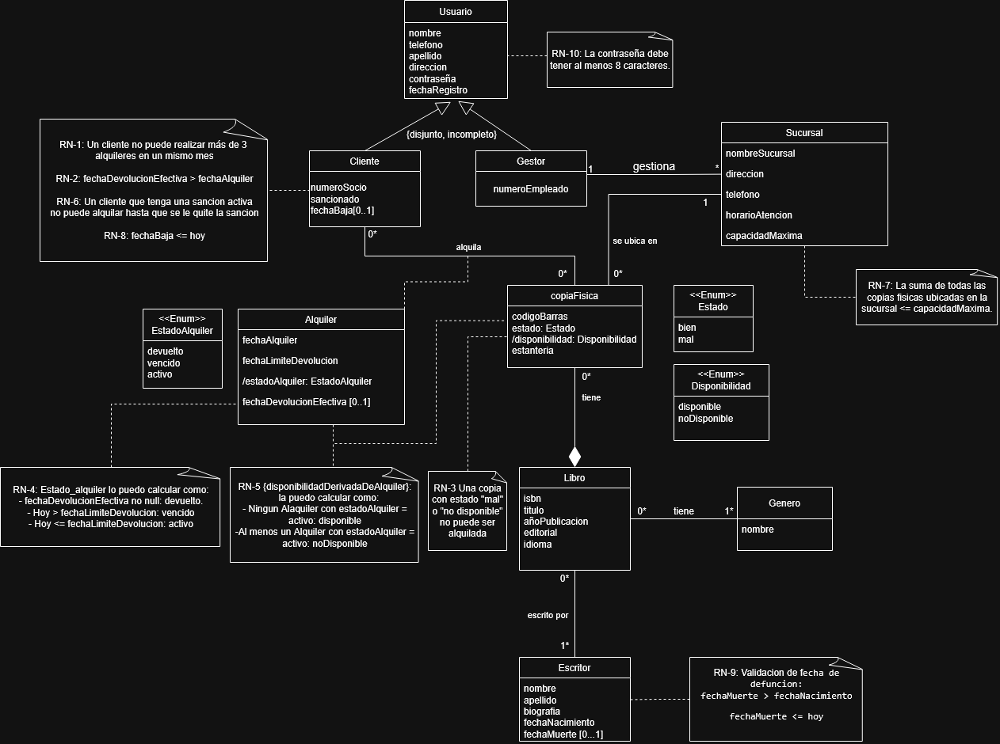
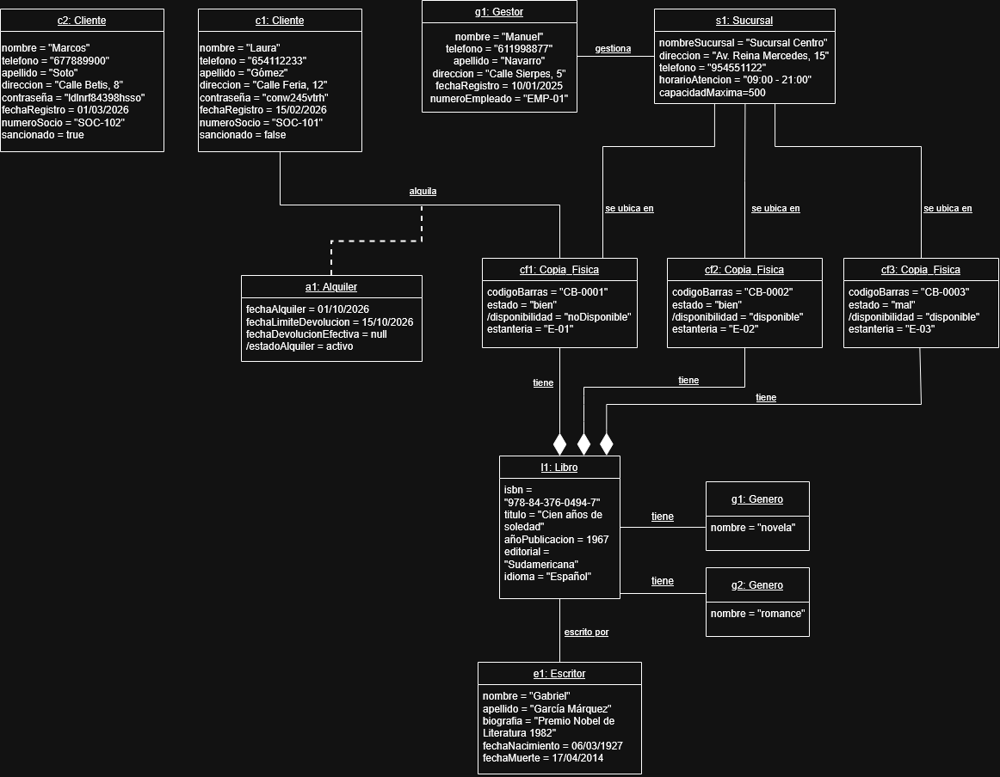

# Rincón del Libro

## Miembros del grupo L6-DF-5

1. Guerrero Fuentes, Alexandro
2. Leon Galdino, Marianna Andrea

## 1. Introducción al problema

### 1.1. Descripción del problema
El cliente solicita el desarrollo de un sistema de información para la gestión de una biblioteca que dispone de un catálogo de libros y de diferentes sucursales donde se almacenan y prestan ejemplares físicos a los usuarios.
El objetivo principal del proyecto es desarrollar una base de datos que permita almacenar, organizar y consultar toda la información relacionada con el funcionamiento de la biblioteca, facilitando la gestión de los libros, sus ejemplares físicos, los usuarios, los creadores de las obras, las sucursales y los préstamos realizados.
La biblioteca necesita disponer de un sistema centralizado que permita conocer en todo momento qué libros forman parte de su catálogo, cuántos ejemplares existen de cada obra, en qué sucursal se encuentra cada ejemplar y cuáles están disponibles para ser prestados. Asimismo, es necesario mantener un registro de los préstamos y las devoluciones para poder consultar qué usuarios tienen libros prestados y cuándo deben devolverlos.
Para satisfacer estas necesidades, se propone diseñar e implementar una base de datos relacional que permita gestionar la información de forma estructurada, segura y consistente.

### 1.2. Situación actual y problemas detectados

La gestión de una biblioteca puede resultar compleja cuando aumenta el número de libros, ejemplares, usuarios y préstamos. Si la información se almacena en documentos independientes o en sistemas no integrados, pueden aparecer problemas que dificulten el funcionamiento de la organización.

Entre los principales problemas que se pretende solucionar se encuentran los siguientes:
- **Falta de centralización de la información**: los datos de los libros, usuarios y préstamos pueden encontrarse distribuidos en diferentes documentos o sistemas.
- **Dificultad para conocer la disponibilidad**: no siempre resulta sencillo determinar si un ejemplar está disponible, prestado o pendiente de devolución.
- **Control insuficiente de los préstamos**: es necesario saber qué usuario tiene cada ejemplar y cuándo debe devolverlo.
- **Gestión de múltiples ejemplares**: una misma obra puede tener varias copias físicas, por lo que es necesario identificar cada ejemplar individualmente.
- **Organización de las sucursales**: cuando la biblioteca dispone de varias ubicaciones, se necesita conocer dónde está asignado cada ejemplar.
- **Duplicidad e inconsistencia de los datos**: registrar repetidamente la información de una misma obra o usuario puede generar errores y dificultar su actualización.
- **Dificultad para obtener información**: los gestores necesitan realizar consultas rápidas sobre los libros disponibles, los préstamos activos y el historial de los usuarios.

### 1.3. Expectativas del cliente

El cliente espera disponer de un sistema que facilite la administración de la biblioteca y mejore el acceso a la información.

En concreto, se espera que la solución permita centralizar los datos, agilizar las consultas, controlar los préstamos y las devoluciones, reducir los errores administrativos y mantener un inventario actualizado de los ejemplares físicos.

Además, el sistema deberá garantizar que la información esté correctamente relacionada, evitando situaciones como registrar préstamos de libros inexistentes o prestar simultáneamente el mismo ejemplar a varios usuarios.

En definitiva, el proyecto pretende proporcionar una solución que permita a la biblioteca gestionar sus recursos de manera organizada, mantener información fiable y ofrecer un servicio de préstamo más eficiente.

## 2. Glosario de términos

- ISBN: Código normalizado internacional que identifica de forma única un libro.

## 3. Visión general del sistema

### 3.1. Requisitos generales

  - **R.G.1. Gestión de usuarios**: El sistema permitirá administrar las cuentas base de acceso, autenticación y perfiles de los usuarios de la plataforma.
  - **R.G.2. Gestión de clientes**: El sistema permitirá administrar el registro de socios, su condición de sanción y sus solicitudes de baja.
  - **R.G.3. Gestión de gestores**: El sistema permitirá administrar los expedientes del personal bibliotecario y la asignación de sus responsabilidades laborales.
  - **R.G.4. Gestión de alquileres**: El sistema permitirá controlar los préstamos y las devoluciones de libros, supervisando el flujo de ejemplares y el cumplimiento de plazos.
  - **R.G.5. Gestión de libros**: El sistema permitirá catalogar los títulos bibliográficos clasificándolos por escritores y géneros literarios.
  - **R.G.6. Gestión de copias físicas**: El sistema permitirá inventariar cada ejemplar físico, controlando su localización en estantería y su estado de conservación.
  - **R.G.7. Gestión de sucursales**: El sistema permitirá administrar las diferentes sedes físicas de la biblioteca, sus datos de contacto y sus límites de capacidad.

    
### 3.2. Usuarios del sistema 

**Clientes**: personas que utilizan los servicios de la biblioteca. 
**Gestores**: trabajadores responsables de administrar la biblioteca.

## 4. Catálogo de requisitos

### 4.1. Requisitos de información

#### R.I.1. Información de usuarios
Como gestor del sistema, quiero registrar y consultar la información de los usuarios para mantener sus datos identificativos y de contacto (nombre, apellidos, teléfono, dirección y fecha de registro).

#### R.I.2. Información de clientes
Como gestor del sistema, quiero registrar y consultar los datos específicos de los clientes para gestionar su condición de socios en la biblioteca (número de socio, estado de sanción y fecha de baja).

#### R.I.3. Información de gestores
Como administrador del sistema, quiero registrar y consultar la información de los gestores para identificar al personal laboral y asignarles sus sucursales de trabajo (número de empleado y sucursales asignadas).

#### R.I.4. Información de alquileres
Como gestor del sistema, quiero registrar y consultar la información de los alquileres para controlar las operaciones de préstamo y conservar su historial (fecha de alquiler, fecha límite de devolución, fecha de devolución efectiva y estado del alquiler).

#### R.I.5. Información de libros
Como gestor del sistema, quiero registrar y consultar la información del catálogo bibliográfico para mantener actualizado el fondo de obras (ISBN, título, año de publicación, editorial, idioma, escritores y géneros literarios asociados).

#### R.I.6. Información de copias físicas
Como gestor del sistema, quiero registrar y consultar la información de los ejemplares físicos para controlar su localización y estado de conservación (código de barras, estado físico, estantería, disponibilidad derivada, libro asociado y sucursal de depósito).

#### R.I.7. Información de sucursales
Como gestor del sistema, quiero registrar y consultar la información de las sucursales para conocer sus datos de contacto, horarios y límites de inventario (nombre de la sucursal, dirección, teléfono, horario de atención y capacidad máxima de ejemplares).

### 4.2. Reglas de negocio

#### R.N.1. Límite de alquileres por cliente
Un cliente no puede realizar más de 3 alquileres en un mismo mes.

#### R.N.2. Validación de la fecha de devolución efectiva
La fecha en la que el cliente devuelve físicamente el ejemplar debe ser estrictamente posterior a la fecha en la que se formalizó el alquiler.

#### R.N.3. Copia alquilable
Solo pueden prestarse aquellas copias físicas que se encuentren en buen estado de conservación (estado = bien) y que no estén prestadas a otro socio (disponibilidad = disponible).

#### R.N.4. Estado del alquiler calculable
El estado de un alquiler se calcula de la siguiente forma:
- Si la fecha de devolución no es nula, el estado es "devuelto".
- Si hoy es posterior a la fecha límite de devolución, el estado es "vencido".
- Si hoy es anterior o igual a la fecha límite de devolución, el estado es "activo".

#### R.N.5. Disponibilidad derivada de los alquileres
La disponibilidad de una copia física se deriva de sus alquileres:
- "disponible": no tiene ningún alquiler activo.
- "noDisponible": tiene al menos un alquiler activo

#### R.N.6. Clientes con sanción activa
Un cliente que tenga una sanción vigente no puede realizar nuevos alquileres mientras dure dicha restricción.

#### R.N.7. Capacidad máxima de la sucursal
Restricción de inventario físico que impide asignar más copias físicas en una sede si se alcanza o supera el límite de espacio establecido en "capacidadMaxima".

#### R.N.8. Validación de fecha de baja
Restricción temporal que impide registrar fechas de baja futuras en el expediente del cliente; la baja debe ser efectiva en el día de hoy o haber ocurrido en el pasado.

### 4.3. Requisitos funcionales

#### **R.F.1 Usuarios**

##### **R.F.1.1. Consulta de perfil**
Como usuario, quiero ver mis datos personales registrados para verificar mi información.
**Pruebas de aceptación**:
  - R.F.1.1.1 Comprobar que el usuario visualiza su nombre, apellidos, dirección y teléfono registrados.

##### **R.F.1.2. Inicio de sesión**
Como usuario, quiero autenticarme en el sistema con mis credenciales para acceder a mis funcionalidades.
**Pruebas de aceptación**:
  - R.F.1.2.1 Comprobar que se permite el acceso al introducir credenciales válidas.
  - R.F.1.2.2 Comprobar que se deniega el acceso al introducir credenciales erróneas.

##### **R.F.1.3. Restablecimiento de contraseña**
Como usuario, quiero recuperar el acceso a mi cuenta para operar si olvido mi clave.
**Pruebas de aceptación**:
  - R.F.1.3.1 Comprobar que el sistema genera un mecanismo de cambio de contraseña ante una petición válida.

##### **R.F.1.4. Registro de usuario**
Como usuario, quiero darme de alta en el sistema para disponer de cuenta en la biblioteca.
**Pruebas de aceptación**:
  - R.F.1.4.1 Comprobar que el sistema exige y almacena los datos de contacto (teléfono y dirección) del usuario (R.I.1).
  - R.F.1.4.2 Comprobar que el sistema almacena la fecha de registro en el momento del alta (R.I.1).

#### **R.F.2 Clientes**

##### **R.F.2.1. Listado de clientes**
Como gestor, quiero obtener la lista completa de socios para consultar su información base.
**Pruebas de aceptación**:
  - R.F.2.1.1 Comprobar que el listado muestra el número de socio, nombre y teléfono de cada cliente.

##### **R.F.2.2. Creación de cliente**
Como gestor, quiero registrar a un nuevo socio asignándole su número identificativo.
**Pruebas de aceptación**:
  - R.F.2.2.1 Comprobar que no se permite crear un cliente con un número de socio ya existente.

##### **R.F.2.3. Consulta de condición de cliente**
Como gestor, quiero comprobar el estado de sanción de un socio para autorizar operaciones.
**Pruebas de aceptación**:
  - R.F.2.3.1 Comprobar que el sistema indica claramente si el cliente figura como sancionado (R.N.6).

##### **R.F.2.4. Borrado de cliente**
Como gestor, quiero registrar la baja de un socio para finalizar su vinculación con el centro.
**Pruebas de aceptación**:
  - R.F.2.4.1 Comprobar que se registra la fecha de baja asegurando que no sea una fecha futura (R.N.8).

#### **R.F.3 Gestores**

##### **R.F.3.1. Listado de gestores**
Como administrador, quiero consultar la plantilla de gestores para conocer el personal activo.
**Pruebas de aceptación**:
  - R.F.3.1.1 Comprobar que se muestran los números de empleado y datos identificativos de los gestores.

##### **R.F.3.2. Creación de gestor**
Como administrador, quiero dar de alta a un gestor asignándole su número laboral.
**Pruebas de aceptación**:
  - R.F.3.2.1 Comprobar que se registra un gestor asociándolo a un usuario base válido.

##### **R.F.3.3. Modificación de gestor**
Como administrador, quiero actualizar los datos laborales de un gestor para reflejar cambios.
**Pruebas de aceptación**:
  - R.F.3.3.1 Comprobar que se guardan correctamente los cambios en los datos del gestor.

##### **R.F.3.4. Borrado de gestor**
Como administrador, quiero retirar los privilegios a un gestor que finaliza su relación laboral.
**Pruebas de aceptación**:
  - R.F.3.4.1 Comprobar que el gestor dado de baja pierde sus permisos de administración.

#### **R.F.4 Alquileres**

##### **R.F.4.1. Listado de alquileres activos**
Como gestor, quiero ver los préstamos en curso para conocer qué libros están fuera.
**Pruebas de aceptación**:
  - R.F.4.1.1 Comprobar que solo se listan alquileres cuyo estado calculado sea "activo" (R.N.4).

##### **R.F.4.2. Listado de alquileres vencidos**
Como gestor, quiero listar los préstamos no devueltos fuera de plazo para reclamarlos.
**Pruebas de aceptación**:
  - R.F.4.2.1 Comprobar que aparecen los alquileres cuyo estado calculado sea "vencido" (R.N.4).

##### **R.F.4.3. Registro de préstamo**
Como gestor, quiero formalizar un alquiler asignando una copia física a un socio.
**Pruebas de aceptación**:
  - R.F.4.3.1 Comprobar que el sistema deniega el alquiler si el socio supera los 3 préstamos al mes (R.N.1).
  - R.F.4.3.2 Comprobar que el sistema deniega el alquiler si el socio está sancionado (R.N.6).
  - R.F.4.3.3 Comprobar que se rechaza el préstamo si la copia física está en estado "mal" o "noDisponible" (R.N.3).

##### **R.F.4.4. Registro de devolución**
Como gestor, quiero registrar la entrega de un ejemplar anotando la fecha efectiva.
**Pruebas de aceptación**:
  - R.F.4.4.1 Comprobar que la fecha de devolución efectiva no puede ser anterior a la de alquiler (R.N.2).
  - R.F.4.4.2 Comprobar que, tras la devolución, el estado del alquiler pasa a "devuelto" (R.N.4).

#### **R.F.5 Libros**

##### **R.F.5.1. Listado del catálogo de libros**
Como usuario, quiero examinar los títulos del catálogo para conocer la oferta bibliográfica.
**Pruebas de aceptación**:
  - R.F.5.1.1 Comprobar que el listado muestra título, ISBN, editorial, año e idioma de cada obra.

##### **R.F.5.2. Filtrado de libros**
Como usuario, quiero buscar libros por género literario o escritor para acotar resultados.
**Pruebas de aceptación**:
  - R.F.5.2.1 Comprobar que la búsqueda devuelve únicamente las obras coincidentes con el criterio.

##### **R.F.5.3. Consulta de detalle de un libro**
Como usuario, quiero consultar la ficha técnica completa de una obra seleccionada.
**Pruebas de aceptación**:
  - R.F.5.3.1 Comprobar que se muestran todos los escritores y todos los géneros asociados al libro.

##### **R.F.5.4. Alta de libro en catálogo**
Como gestor, quiero añadir una nueva obra asegurando su correcta catalogación.
**Pruebas de aceptación**:
  - R.F.5.4.1 Comprobar que el sistema impide registrar un libro si no se le asocia al menos un escritor y al menos un género literario (R.I.5).
  - R.F.5.4.2 Comprobar que el sistema deniega el alta si se introduce un ISBN que ya existe en el catálogo (R.I.5).

#### **R.F.6 Copias Físicas**

##### **R.F.6.1. Listado de copias por libro**
Como gestor, quiero conocer todas las copias físicas correspondientes a un libro concreto.
**Pruebas de aceptación**:
  - R.F.6.1.1 Comprobar que se listan todos los ejemplares asociados al ISBN seleccionado.

##### **R.F.6.2. Consulta de disponibilidad de ejemplar**
Como cliente, quiero comprobar si una copia física concreta está disponible para préstamo.
**Pruebas de aceptación**:
  - R.F.6.2.1 Comprobar que el estado de disponibilidad mostrado coincide con la regla de negocio (R.N.5).

##### **R.F.6.3. Registro de nueva copia física**
Como gestor, quiero dar de alta un nuevo ejemplar asignándole código de barras y estantería.
**Pruebas de aceptación**:
  - R.F.6.3.1 Comprobar que el sistema deniega el alta si la sucursal ha alcanzado su capacidad máxima (R.N.7).

##### **R.F.6.4. Modificación de estado físico de copia**
Como gestor, quiero actualizar la condición física de un ejemplar a "bien" o "mal".
**Pruebas de aceptación**:
  - R.F.6.4.1 Comprobar que, si una copia se marca como "mal", el sistema impide nuevos alquileres (R.N.3).

#### **R.F.7 Sucursales**

##### **R.F.7.1. Listado de sucursales**
Como usuario, quiero ver la relación de sedes físicas existentes para saber dónde acudir.
**Pruebas de aceptación**:
  - R.F.7.1.1 Comprobar que se muestran el nombre, dirección y teléfono de cada sede.
    
##### **R.F.7.2. Consulta de horario de sucursal**
Como cliente, quiero conocer el horario de apertura de una sede seleccionada.
**Pruebas de aceptación**:
  - R.F.7.2.1 Comprobar que se visualizan los días y horas de atención al público de la sede elegida.

##### **R.F.7.3. Alta de sucursal**
Como gestor, quiero registrar una nueva sede estableciendo su límite de almacenamiento.
**Pruebas de aceptación**:
  - R.F.7.3.1 Comprobar que se registra obligatoriamente el atributo de capacidad máxima (R.N.7).

##### **R.F.7.4. Consulta de ocupación de sucursal**
Como gestor, quiero comprobar el volumen de ejemplares en depósito frente al límite de la sede.
**Pruebas de aceptación**:
  - R.F.7.4.1 Comprobar que se muestra el total de copias físicas y el porcentaje respecto a la capacidad máxima

### 4.4. Requisitos no funcionales

#### R.N.F.1. Seguridad de usuarios:
Las contraseñas deben almacenarse mediante algoritmos de cifrado unidireccional con sal (salt) para garantizar la privacidad.

#### R.N.F.2. Protección de datos de clientes
Los clientes solo tendrán acceso a sus propios datos personales y a su propio historial de alquileres.

#### R.N.F.3. Trazabilidad administrativa de gestores 
Todas las operaciones de alta y baja realizadas por un gestor deben quedar registradas en un registro de auditoría con su número de empleado.

#### R.N.F.4. Inmutabilidad de alquileres
Una vez registrado un alquiler o una devolución, los registros históricos no podrán ser modificados ni eliminados del sistema.

#### R.N.F.5. Rendimiento de catálogo de libros
Las búsquedas y filtros en el catálogo bibliográfico deben completarse en un tiempo inferior a 1,5 segundos.

#### R.N.F.6. Consistencia transaccional de inventario
El cálculo de disponibilidad de una copia física debe ser estrictamente transaccional para evitar dobles alquileres simultáneos.

#### R.N.F.7. Disponibilidad de servicio por sucursales
El sistema debe garantizar una disponibilidad ininterrumpida de al menos el 99,5% durante los horarios de atención de las sucursales.

### 4.5. Mapa de historias de usuario

| Actividad | Tarea | Historia de usuario | Prioridad |
|-----------|-------|---------------------|-----------|
| Catálogo de libros | Buscar libros | Como cliente, quiero buscar libros por título para localizar las obras que me interesan. | Alta |
| Catálogo de libros | Consultar disponibilidad | Como cliente, quiero conocer qué ejemplares están disponibles y en qué sucursal. | Alta |
| Catálogo de libros | Registrar libros | Como gestor, quiero registrar libros y creadores para mantener actualizado el catálogo. | Alta |
| Catálogo de libros | Registrar copias físicas | Como gestor, quiero registrar copias físicas y asignarlas a sucursales. | Alta |
| Catálogo de libros | Consultar información | Como cliente, quiero consultar la información detallada de un libro para decidir si me interesa. | Media |
| Catálogo de libros | Filtrar resultados | Como cliente, quiero filtrar los libros por escritor, género, editorial e idioma para encontrar obras de mi interés. | Media |
| Gestión de sucursales | Consultar sucursales | Como cliente, quiero consultar las direcciones, teléfonos y horarios de las sucursales para saber dónde acudir. | Media |
| Gestión de sucursales | Consultar copias físicas | Como gestor, quiero consultar las copias físicas por libro o sucursal, incluyendo su estado y estantería, para localizar los ejemplares. | Alta |
| Gestión de clientes | Registrar clientes | Como gestor, quiero registrar nuevos clientes para permitirles utilizar los servicios de la biblioteca. | Alta |
| Gestión de clientes | Gestionar sanciones | Como gestor, quiero registrar y actualizar sanciones para controlar las restricciones aplicadas a los clientes. | Media |
| Gestión de alquileres | Consultar alquileres propios | Como cliente, quiero consultar mis alquileres activos y las fechas previstas de devolución. | Alta |
| Gestión de alquileres | Registrar alquileres | Como gestor, quiero registrar alquileres para saber qué ejemplares tiene cada cliente. | Alta |
| Gestión de alquileres | Registrar devoluciones | Como gestor, quiero registrar devoluciones para actualizar la disponibilidad de los ejemplares. | Alta |
| Gestión de alquileres | Consultar historial | Como gestor, quiero consultar el historial de alquileres para revisar las operaciones realizadas. | Media |
| Gestión de alquileres | Consultar alquileres activos | Como gestor, quiero consultar los alquileres activos para realizar el seguimiento de los ejemplares alquilados. | Alta |
| Gestión de alquileres | Consultar alquileres vencidos | Como gestor, quiero consultar los alquileres vencidos para identificar las devoluciones pendientes. | Media |
| Gestión de alquileres | Validar disponibilidad | Como gestor, quiero que el sistema compruebe la disponibilidad de una copia antes de registrar un alquiler para evitar asignaciones duplicadas. | Alta |
| Gestión de alquileres | Validar clientes | Como gestor, quiero que el sistema compruebe que un cliente cumple las condiciones antes de registrar un alquiler. | Alta |

## 5. Modelo conceptual

### 5.1. Diagrama de clases UML

### 5.2. Escenarios de prueba
#### 5.2.1. Diagrama de escenario de prueba UML:

#### 5.2.2. Descripción textual:
Se comprueba el comportamiento del sistema ante operaciones de consulta y préstamo sobre una sede física:

1. **Gestión de la sede:**
   - La sede **"Sucursal Centro"** (s1: Sucursal) está gestionada por el empleado **Manuel Navarro** (g1: Gestor), vinculado mediante el enlace "gestiona".

2. **Catálogo y autores:**
   - En el catálogo está registrada la novela **"Cien años de soledad"** (l1: Libro), cuyo autor es **Gabriel García Márquez** (e1: Escritor), relacionados mediante el enlace "escribe".

3. **Copias físicas y disponibilidad (RN-3 y RN-5):**
   - El libro se compone mediante "tiene" de tres ejemplares físicos ubicados en la sucursal ("se ubica en"):
     - **cf1: Copia_Fisica**: En estantería "E-01", en estado "bien". Al tener un alquiler activo en curso (a1: Alquiler), la regla **RN-5** deriva su disponibilidad a /disponibilidad = "noDisponible".
     - **cf2: Copia_Fisica**: En estantería "E-02", en estado "bien". No tiene ningún alquiler activo, por lo que **RN-5** deriva su disponibilidad a /disponibilidad = "disponible". Es un ejemplar completamente apto para ser alquilado (**RN-3**).
     - **cf3: Copia_Fisica**: En estantería "E-03", en estado "mal". Aunque no tiene alquileres activos y figura como /disponibilidad = "disponible", la regla **RN-3** impide que pueda alquilarse debido a su deterioro físico.

4. **Operaciones de clientes (RN-1, RN-4 y RN-6):**
   - **c1: Cliente (Laura Gómez)**: Socia no sancionada (sancionado = null). Tiene en curso el alquiler **a1: Alquiler** sobre la copia **cf1** mediante el enlace "alquila". Al ser su único préstamo del mes, cumple el límite máximo de 3 alquileres mensuales (**RN-1**). Como la fecha de devolución efectiva no se ha registrado (fechaDevolucionEfectiva = null) y aún no ha vencido la fecha límite (15/10/2026), el estado del alquiler se calcula como "activo" (**RN-4**).
   - **c2: Cliente (Marcos Soto)**: Socio con sanción activa (sancionado = true). En aplicación de la regla **RN-6**, el sistema bloquea cualquier intento de registrar un nuevo alquiler a su nombre mientras persista la sanción.

## 6. Matrices de trazabilidad

|       | Entidad Usuario | Entidad Gestor | Entidad Sucursal | Entidad Cliente | Entidad Alquiler | Entidad Copia_Fisica | Entidad Libro |  Entidad Escritor | 
|:------|:-----------|:-----------|:-----------|:-----------|:-----------|:-----------|:-----------|:-----------|
| RG-1  |   
 x 
     |      x      |            |            |            |            |           |           |                
| RG-2  |            |     x      |            |           |           |   x        |           |           |           
| RG-3  |       x     |           |            |           |           |           |           |           |          
| RG-4  |            |      x     |     x       |      x     |           |           |           |           |          
| RG-5  |     x       |           |            |           |      x     |     x      |           |           |           
| RG-6  |      x      |          |            |           |           |           |           |           |           
| RG-7  |            |     x      |            |    x       |    x       |           |           |           |          
| RG-8  |      x      |           |            |           |           |    x       |     x      |      x     |    

|       | Entidad Usuario | Entidad Gestor | Entidad Sucursal | Entidad Cliente | Entidad Alquiler | Entidad Copia_Fisica | Entidad Libro |  Entidad Escritor | 
|:------|:-----------|:-----------|:-----------|:-----------|:-----------|:-----------|:-----------|:-----------|
| RI-1  |   
 x 
     |      x      |            |            |            |            |           |           |                
| RI-2  |            |     x      |            |           |           |   x        |           |           |           
| RI-3  |       x     |           |            |           |           |           |           |           |          
| RI-4  |            |      x     |     x       |      x     |           |           |           |           |          
| RI-5  |     x       |           |            |           |      x     |     x      |           |           |           
| RI-6  |      x      |          |            |           |           |           |           |           |           
| RI-7  |            |     x      |            |    x       |    x       |           |           |           |          
| RI-8  |      x      |           |            |           |           |    x       |     x      |      x     |           
     

|       | Entidad Usuario | Entidad Gestor | Entidad Sucursal | Entidad Cliente | Entidad Alquiler | Entidad Copia_Fisica | Entidad Libro |  Entidad Escritor | 
|:------|:-----------|:-----------|:-----------|:-----------|:-----------|:-----------|:-----------|:-----------|          
| RF-1  |            |           |            |           |           |     x      |           |           |         
| RF-2  |           |            |      x     |     x     |           |      x     |           |           |           
| RF-3  |           |      x     |      x     |      x     |     x      |           |           |           |          
| RF-4  |           |      x      |           |           |           |     x      |           |           |         
| RF-5  |           |       x     |           |           |           |     x      |           |           |          
| RF-6  |           |      x      |           |           |           |    x       |     x      |     x      |           
| RF-7  |           |     x       |           |           |           |      x     |       x    |     x      |         
| RF-8  |           |            |           |           |           |    x       |           |           |          
| RF-9  |           |            |           |    x       |           |     x      |           |           |           
| RF-10 |           |      x      |     x      |     x      |     x      |           |           |           |          
| RF-11 |           |            |          |           |           |      x     |           |           |          

-- fin entregable 2 --

## 7. Modelo relacional en 3FN

- Relaciones obtenidas al aplicar la transformación del modelo conceptual.

### 7.1.  Justificación de la estrategia de transformación de jerarquías

- si se identificaron jerarquías en el MC.

### 8. Matriz de trazabilidad MC/SQL (opcional):

- Restricciones sobre el MC / Elementos del modelo tecnológico (SQL) (Triggers, checks, etc.)
- Incluir Reglas de negocio — Constraints/Triggers en las matrices de trazabilidad para el entregable 3

|       | EntidadX   | Entidad AsociaciónX  | Reglas negocio | Entidad2 ...   | 
|:-------|:-------|:-------|:-------|:-------|
| TABLA-1 |        |        |        |        |
| TABLA-2 |        |        |        |        |
| TABLA-3 |        |        |        |        |
| TABLA-4 |        |        |        |        |
| TRIG-1 |        |        |        |        |
| TRIG-2 | X      | X      |        | X      |
| TRIG-3 |        | X      |        | X      |
| TRIG-4 |        |        | X      |        |
| CONST-1 |        |        |        |        |
| CONST-2 | X      | X      |        | X      |
| CONST-3 |        | X      |        | X      |
| CONST-4 |        |        | X      |        |

Se consideran todo tipo de constraints declarativas (aquellas definidas durante el CREATE TABLE).
-- fin entregable 3 --

## Referencias

Gemini/ChatGPT - Consultas varias sobre Biblioteca (funcionamiento,problemas,etc) [https://gemini.google.com/app?hl=es] [https://chatgpt.com/]

Lucid - Como crear mapa historia de usuario [https://lucid.co/es/blog/como-crear-un-mapa-de-historias-de-usuario]

Github.docs - Escritura y formato en Markdown[https://docs.github.com/es/get-started/writing-on-github/getting-started-with-writing-and-formatting-on-github/basic-writing-and-formatting-syntax]
