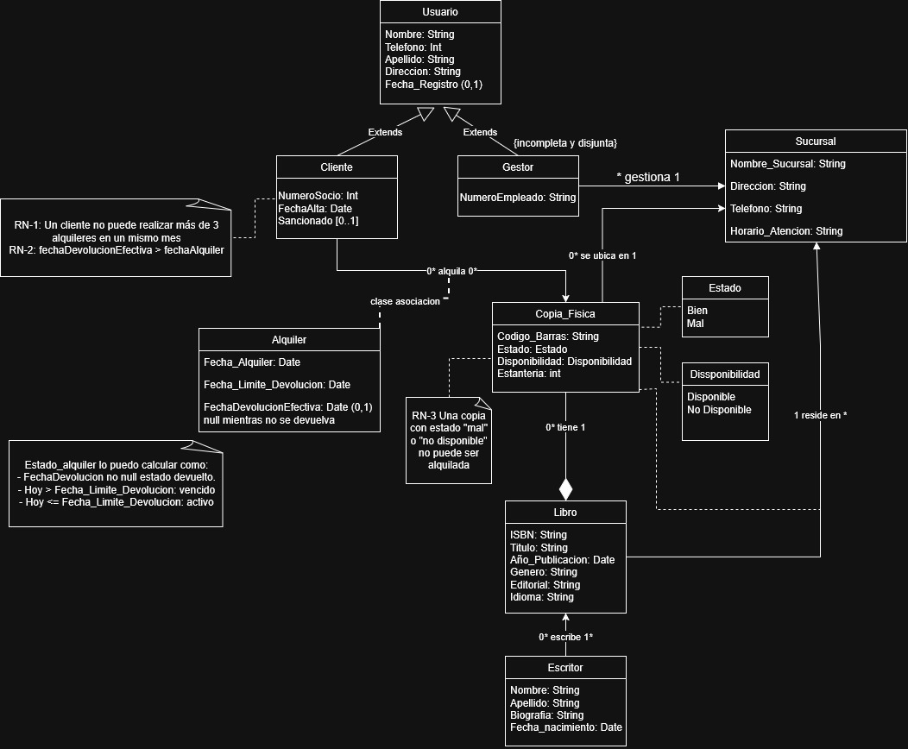

# Rincón del Libro

## Miembros del grupo L6-DF-5

1. Guerrero Fuentes, Alexandro
2. Leon Galdino, Marianna Andrea

## 1. Introducción al problema

### 1.1. Descripción del problema
El cliente solicita el desarrollo de un sistema de información para la gestión de una biblioteca que dispone de un catálogo de libros y de diferentes sucursales donde se almacenan y prestan ejemplares físicos a los usuarios.
El objetivo principal del proyecto es desarrollar una base de datos que permita almacenar, organizar y consultar toda la información relacionada con el funcionamiento de la biblioteca, facilitando la gestión de los libros, sus ejemplares físicos, los usuarios, los creadores de las obras, las sucursales y los préstamos realizados.
La biblioteca necesita disponer de un sistema centralizado que permita conocer en todo momento qué libros forman parte de su catálogo, cuántos ejemplares existen de cada obra, en qué sucursal se encuentra cada ejemplar y cuáles están disponibles para ser prestados. Asimismo, es necesario mantener un registro de los préstamos y las devoluciones para poder consultar qué usuarios tienen libros prestados y cuándo deben devolverlos.
Para satisfacer estas necesidades, se propone diseñar e implementar una base de datos relacional que permita gestionar la información de forma estructurada, segura y consistente.

### 1.2. Situación actual y problemas detectados

La gestión de una biblioteca puede resultar compleja cuando aumenta el número de libros, ejemplares, usuarios y préstamos. Si la información se almacena en documentos independientes o en sistemas no integrados, pueden aparecer problemas que dificulten el funcionamiento de la organización.

Entre los principales problemas que se pretende solucionar se encuentran los siguientes:
- **Falta de centralización de la información**: los datos de los libros, usuarios y préstamos pueden encontrarse distribuidos en diferentes documentos o sistemas.
- **Dificultad para conocer la disponibilidad**: no siempre resulta sencillo determinar si un ejemplar está disponible, prestado o pendiente de devolución.
- **Control insuficiente de los préstamos**: es necesario saber qué usuario tiene cada ejemplar y cuándo debe devolverlo.
- **Gestión de múltiples ejemplares**: una misma obra puede tener varias copias físicas, por lo que es necesario identificar cada ejemplar individualmente.
- **Organización de las sucursales**: cuando la biblioteca dispone de varias ubicaciones, se necesita conocer dónde está asignado cada ejemplar.
- **Duplicidad e inconsistencia de los datos**: registrar repetidamente la información de una misma obra o usuario puede generar errores y dificultar su actualización.
- **Dificultad para obtener información**: los gestores necesitan realizar consultas rápidas sobre los libros disponibles, los préstamos activos y el historial de los usuarios.

### 1.3. Expectativas del cliente

El cliente espera disponer de un sistema que facilite la administración de la biblioteca y mejore el acceso a la información.

En concreto, se espera que la solución permita centralizar los datos, agilizar las consultas, controlar los préstamos y las devoluciones, reducir los errores administrativos y mantener un inventario actualizado de los ejemplares físicos.

Además, el sistema deberá garantizar que la información esté correctamente relacionada, evitando situaciones como registrar préstamos de libros inexistentes o prestar simultáneamente el mismo ejemplar a varios usuarios.

En definitiva, el proyecto pretende proporcionar una solución que permita a la biblioteca gestionar sus recursos de manera organizada, mantener información fiable y ofrecer un servicio de préstamo más eficiente.

## 2. Glosario de términos

- ISBN: Código normalizado internacional que identifica de forma única un libro.

## 3. Visión general del sistema

### 3.1. Requisitos generales

El sistema deberá cumplir los siguientes requisitos generales:
  - Gestión de usuarios: el sistema permitirá distinguir entre clientes y gestores y controlar las operaciones que puede realizar cada tipo de
    usuario.
  - Gestión del catálogo: se podrán registrar y consultar libros y sus creadores.
  - Gestión de ejemplares: cada copia física estará identificada individualmente y asociada a un libro, una sucursal, y constara si esta alquilada
    y su estado de conservación.
  - Gestión de sucursales: se almacenará la información de las diferentes sucursales de la biblioteca.
  - Gestión de Alquileres: el sistema permitirá registrar préstamos, controlar las fechas previstas de devolución y registrar las devoluciones.
    
### 3.2. Usuarios del sistema 

**Clientes**: personas que utilizan los servicios de la biblioteca. 
**Gestores**: trabajadores responsables de administrar la biblioteca.

## 4. Catálogo de requisitos

### 4.1. Requisitos funcionales (PRUEBAS ACEPTACION Quedan solo aqui)

#### R.F.01. Listado del catálogo de libros 

Como cliente, 
quiero obtener un listado de los libros pudiendo filtrar por título, escritor, género, editorial o idioma, 
para localizar obras de mi interés. 

**Prueba de aceptación**
- Verificar que el sistema muestra el catálogo de libros y permite filtrar por título, escritor, género, editorial e idioma, devolviendo únicamente los libros que cumplen los criterios seleccionados.
- Verificar que, al realizar una búsqueda sin resultados coincidentes, el sistema muestra un listado vacío e informa al usuario de que no se han encontrado libros.
- Se debe aplicar la regla de negocio R.N.02, garantizando que cada copia física esté asociada a un único libro, y la regla R.N.08, permitiendo relacionar libros con varios creadores y viceversa.

#### R.F.02. Consultar disponibilidad de un libro

Como cliente, 
quiero consultar la disponibilidad de un libro (qué copias físicas están disponibles y en qué sucursal se encuentran), 
para saber si puedo alquilarlo.

**Prueba de aceptación**
- Verificar que el sistema muestra las copias físicas disponibles del libro seleccionado, indicando la sucursal en la que se encuentra cada una.
- Verificar que, cuando todas las copias físicas del libro están prestadas, el sistema indica que no hay ejemplares disponibles para préstamo.
- Se debe aplicar la regla de negocio R.N.02, garantizando que cada copia corresponda a un único libro; la regla R.N.03, asegurando que cada copia esté asignada a una sucursal; la regla R.N.05, impidiendo que una misma copia tenga más de un préstamo activo simultáneamente; y la regla R.N.07, evitando que una copia prestada se considere disponible.

#### R.F.03. Listado de copias físicas

Como gestor, 
quiero obtener un listado de las copias físicas de un libro o de una sucursal, mostrando su estado y su estantería, 
para localizar los ejemplares.

**Prueba de aceptación**
- Verificar que el gestor puede consultar las copias físicas de un libro concreto y que cada resultado muestra su identificador, estado y estantería.
- Verificar que el gestor puede consultar las copias físicas de una sucursal determinada y que únicamente se muestran las copias asignadas a dicha sucursal.
- Se debe aplicar la regla de negocio R.N.02, garantizando que cada copia física corresponda a un único libro; la regla R.N.03, asegurando que cada copia esté asignada a una sucursal; y la regla R.N.09, permitiendo el acceso a esta funcionalidad únicamente a los gestores.

#### R.F.04. Listado de clientes

Como gestor, 
quiero obtener un listado de los clientes (socios) de la biblioteca con sus datos, 
para tenerlos localizados.

**Prueba de aceptación**
- Verificar que el gestor puede consultar el listado de clientes y que cada registro muestra los datos definidos para el socio, como su identificador, nombre, apellidos y datos de contacto.
- Verificar que cada cliente aparece identificado de forma inequívoca y que no existen identificadores duplicados entre los usuarios registrados.
- Se debe aplicar la regla de negocio R.N.01, garantizando que cada usuario tenga un identificador único, y la regla R.N.09, permitiendo el acceso al listado únicamente a los gestores.

#### R.F.05. Listado de clientes sancionados

Como gestor, 
quiero obtener un listado de los clientes que están sancionados, 
para saber a quiénes no se les puede alquilar.

**Prueba de aceptación**
- Verificar que el sistema muestra únicamente los clientes que tienen una sanción vigente, incluyendo sus datos identificativos y la información de la sanción disponible.
- Verificar que los clientes sin sanciones vigentes no aparecen en el listado y que un cliente deja de aparecer cuando su sanción deja de estar vigente.
- Se debe aplicar la regla de negocio R.N.01, garantizando la identificación única de cada usuario; la regla R.N.04, impidiendo que se realicen préstamos a clientes que no cumplan las condiciones de alta; y la regla R.N.09, reservando esta consulta administrativa a los gestores.

#### R.F.06. Listado de alquileres activos

Como gestor, 
quiero obtener un listado de los alquileres activos (todavía no devueltos), 
para hacer el seguimiento de los préstamos en curso.

**Prueba de aceptación**
- Verificar que el sistema muestra todos los préstamos que todavía no han sido devueltos, indicando los datos del cliente, el libro, la copia física y las fechas del préstamo y de devolución prevista.
- Verificar que, cuando una copia física se devuelve y el préstamo queda registrado como finalizado, dicho préstamo deja de aparecer en el listado de alquileres activos.
- Se debe aplicar la regla de negocio R.N.04, garantizando que los préstamos se realicen a clientes dados de alta; la regla R.N.05, impidiendo que una copia tenga varios préstamos activos simultáneamente; la regla R.N.06, validando las fechas del préstamo y de devolución prevista; la regla R.N.07, controlando la disponibilidad de las copias; y la regla R.N.09, restringiendo la consulta a los gestores.

#### R.F.07. Listado de alquileres vencidos

Como gestor, 
quiero obtener un listado de los alquileres cuya fecha límite de devolución ya ha pasado y aún no han sido devueltos, 
para identificar a los usuarios morosos.

**Prueba de aceptación**
- Verificar que el sistema muestra los préstamos que no han sido devueltos y cuya fecha prevista de devolución es anterior a la fecha actual, indicando el cliente, el libro y los datos del préstamo.
- Verificar que los préstamos cuya fecha prevista de devolución coincide con la fecha actual o es posterior a ella no aparecen como vencidos, y que los préstamos ya devueltos tampoco se incluyen en el listado.
- Se debe aplicar la regla de negocio R.N.01, identificando inequívocamente a cada usuario; la regla R.N.05, garantizando la exclusividad de los préstamos activos por copia; la regla R.N.06, validando las fechas del préstamo y de devolución prevista; la regla R.N.09, reservando esta consulta a los gestores; y la regla R.N.10, conservando los préstamos devueltos en el historial.

#### R.F.08. Listado de escritores

Como cliente, 
quiero consultar el listado de escritores y su información, 
para conocer los autores disponibles en la biblioteca.

**Prueba de aceptación**
- Verificar que el sistema muestra el listado de escritores registrados y la información disponible de cada uno, como su identificador, nombre y datos biográficos, si están definidos.
- Verificar que, al seleccionar un escritor, el sistema permite identificar los libros asociados a él y que un libro con varios creadores aparece relacionado con todos ellos.
- Se debe aplicar la regla de negocio R.N.08, garantizando la relación de varios a varios entre libros y creadores.

#### R.F.09. Listado de sucursales

Como cliente, 
quiero consultar las sucursales de la biblioteca con su dirección, teléfono y horario de atención, 
para saber dónde acudir.

**Prueba de aceptación**
- Verificar que el sistema muestra el listado de sucursales con su dirección, teléfono y horario de atención correspondiente.
- Verificar que, al seleccionar una sucursal, se muestra su información específica y que los datos de las distintas sucursales no se confunden entre sí.
- Se debe aplicar la regla de negocio R.N.03, garantizando que cada copia física esté asignada a una sucursal.

#### R.F.10. Listado de libros de una sucursal

Como gestor, 
quiero consultar los libros que residen en una sucursal determinada, 
para conocer el fondo de cada sede.

**Prueba de aceptación**
- Verificar que el gestor puede seleccionar una sucursal y obtener el listado de libros que tienen copias físicas asignadas a ella.
- Verificar que un libro con varias copias en la misma sucursal aparece una sola vez en el listado de títulos, y que no se muestran libros que únicamente tengan copias asignadas a otras sucursales.
- Se debe aplicar la regla de negocio R.N.02, garantizando la correspondencia entre libros y copias físicas; la regla R.N.03, asegurando que cada copia esté asignada a una sucursal; y la regla R.N.09, permitiendo el acceso a esta consulta únicamente a los gestores.

#### R.F.11. Consultar la información de un libro

Como cliente, 
quiero consultar los datos de un libro concreto (título, escritor/es, año, género, editorial e idioma), 
para decidir si me interesa.

**Prueba de aceptación**
- Verificar que, al seleccionar un libro del catálogo, el sistema muestra su título, escritor o escritores, año de publicación, género, editorial e idioma, siempre que estos datos estén registrados.
- Verificar que, al consultar un libro con varios creadores, el sistema muestra a todos los creadores asociados y que, si el identificador del libro no existe, informa de que no se ha encontrado el libro solicitado.
- Se debe aplicar la regla de negocio R.N.02, garantizando que el libro consultado esté correctamente relacionado con sus copias físicas, y la regla R.N.08, permitiendo que un libro esté asociado a varios creadores.

#### 4.1.1. Requisitos de información

##### R.I.01. Información de usuarios
Como gestor del sistema, 
quiero registrar y consultar la información de los usuarios 
para mantener sus datos personales y de contacto.

**Prueba de aceptación**
- Comprobar que se pueden registrar el nombre y los apellidos del usuario.
- Comprobar que se puede almacenar su teléfono.
- Comprobar que se puede almacenar su dirección.
- Comprobar que la fecha de registro es opcional.
- Comprobar que cada usuario tiene un identificador único.

R.I.02. Información de clientes (socios)
Como gestor del sistema, 
quiero registrar y consultar la información de los clientes
para gestionar su condición de socio y sus préstamos.

**Prueba de aceptación**
- Comprobar que cada cliente tiene un número de socio único.
- Comprobar que se almacena la fecha de alta del cliente.
- Comprobar que se puede registrar si el cliente está sancionado.
- Comprobar que el estado de sanción es opcional.
- Comprobar que cada cliente dispone de los datos comunes de usuario.
- Comprobar que se puede identificar si un cliente está dado de alta.

R.I.03. Información de gestores
Como administrador del sistema, 
quiero registrar y consultar la información de los gestores 
para identificarlos y gestionar sus permisos administrativos.

**Prueba de aceptación**
- Comprobar que cada gestor tiene un número de empleado.
- Comprobar que se almacenan los datos comunes de usuario.
- Comprobar que se puede identificar a cada gestor de forma única.

R.I.04. Información de sucursales
Como gestor del sistema, 
quiero registrar y consultar la información de las sucursales 
para conocer sus datos de contacto y horarios de atención.

**Prueba de aceptación**
- Comprobar que se puede almacenar el nombre de la sucursal.
- Comprobar que se puede registrar su dirección.
- Comprobar que se puede registrar su teléfono.
- Comprobar que se puede almacenar el horario de atención.
- Comprobar que cada sucursal puede identificarse de forma inequívoca.

R.I.05. Información de libros
Como usuario del sistema, 
quiero consultar la información de los libros 
para identificar sus características y conocer en qué sucursales se encuentran.

**Prueba de aceptación**
- Comprobar que se almacena el ISBN del libro.
- Comprobar que se registra el título.
- Comprobar que se puede almacenar el año de publicación.
- Comprobar que se registra el género literario.
- Comprobar que se almacena la editorial.
- Comprobar que se registra el idioma.
- Comprobar que se pueden asociar uno o varios escritores a un libro.
- Comprobar que se puede conocer la sucursal o las sucursales donde reside el libro.

R.I.06. Información de escritores
Como usuario del sistema, 
quiero consultar la información de los escritores 
para conocer sus datos personales y su trayectoria.

**Prueba de aceptación**
- Comprobar que se almacena el nombre y los apellidos del escritor.
- Comprobar que se puede registrar su biografía.
- Comprobar que se puede almacenar su fecha de nacimiento.
- Comprobar que un escritor puede estar relacionado con varios libros.

R.I.07. Información de copias físicas
Como gestor del sistema, 
quiero registrar y consultar la información de las copias físicas 
para controlar su estado, ubicación y disponibilidad.

**Prueba de aceptación**
- Comprobar que cada copia física tiene un código de barras único.
- Comprobar que se registra el estado físico de la copia, que puede ser bien o mal.
- Comprobar que se registra la disponibilidad de la copia, que puede ser disponible o no disponible.
- Comprobar que se puede almacenar la estantería donde se ubica.
- Comprobar que cada copia física está asignada a una sucursal.
- Comprobar que cada copia física corresponde a un único libro.
- Comprobar que un libro puede tener varias copias físicas.

R.I.08. Información de préstamos
Como gestor del sistema, 
quiero registrar y consultar la información de los préstamos 
para controlar los alquileres de copias físicas y conservar su historial.

**Prueba de aceptación**
- Comprobar que se almacena la fecha de inicio del préstamo.
- Comprobar que se registra la fecha límite de devolución.
- Comprobar que la fecha límite de devolución no es anterior a la fecha de inicio del préstamo.
- Comprobar que la fecha de devolución efectiva se registra cuando se devuelve la copia.
- Comprobar que se identifica al cliente que realiza el préstamo.
- Comprobar que se identifica la copia física prestada.
- Comprobar que solo los clientes dados de alta pueden realizar préstamos.
- Comprobar que una misma copia física no puede tener más de un préstamo activo simultáneamente.
- Comprobar que una copia física prestada no aparece como disponible para un nuevo préstamo.
- Comprobar que los préstamos devueltos se conservan para mantener el historial de operaciones.

#### 4.1.2. Reglas de negocio

##### R.N.01. Identificador único de usuarios

Cada usuario debe tener un identificador único.

**Prueba de aceptación**
- Comprobar que el sistema permite registrar un usuario con un identificador que no existe previamente.
- Comprobar que el sistema impide registrar dos usuarios con el mismo identificador.

##### R.N.02. Correspondencia entre libros y copias físicas

Cada copia física debe corresponder a un único libro, aunque un libro pueda tener varias copias.

**Prueba de aceptación**
- Comprobar que el sistema permite asociar varias copias físicas a un mismo libro.
- Comprobar que el sistema impide asociar una misma copia física a más de un libro simultáneamente.

##### R.N.03. Asignación de copias a sucursales

Cada copia física debe estar asignada a una sucursal.

**Prueba de aceptación**
- Comprobar que el sistema permite registrar una copia física asignada a una sucursal existente.
- Comprobar que el sistema impide registrar una copia física sin una sucursal asignada.

##### R.N.04. Validación del estado de alta del cliente

Un préstamo solo puede realizarse a un cliente que este dado de alta.

**Prueba de aceptación**
- Comprobar que el sistema permite realizar un préstamo a un cliente que está dado de alta.
- Comprobar que el sistema impide realizar un préstamo a un cliente que no está dado de alta.

##### R.N.05. Exclusividad de préstamos activos por copia

Una misma copia física no puede tener más de un préstamo activo simultáneamente.

**Prueba de aceptación**
- Comprobar que el sistema permite realizar un préstamo de una copia física que no tiene ningún préstamo activo.
- Comprobar que el sistema impide realizar un nuevo préstamo de una copia física que ya tiene un préstamo activo.
- Comprobar que el sistema permite volver a prestar la copia física una vez que se ha registrado la devolución del préstamo anterior.

##### R.N.06. Validación de fechas de préstamo y devolución

La fecha prevista de devolución no puede ser anterior a la fecha del préstamo.

**Prueba de aceptación**
- Comprobar que el sistema permite registrar un préstamo cuya fecha prevista de devolución es posterior a la fecha del préstamo.
- Comprobar que el sistema permite registrar un préstamo cuya fecha prevista de devolución coincide con la fecha del préstamo, si no existe otra restricción.
- Comprobar que el sistema impide registrar un préstamo cuya fecha prevista de devolución sea anterior a la fecha del préstamo..

##### R.N.07. Control de disponibilidad de copias

Una copia prestada no puede considerarse disponible para un nuevo préstamo.

**Prueba de aceptación**
- Comprobar que el sistema muestra como disponibles las copias físicas que no tienen ningún préstamo activo.
- Comprobar que el sistema muestra como no disponibles las copias físicas que tienen un préstamo activo.
- Comprobar que el sistema impide seleccionar una copia prestada para realizar un nuevo préstamo.
- Comprobar que el sistema actualiza la disponibilidad de una copia física después de registrar su devolución.

##### R.N.08. Correspondencia entre libros y Creadores

Un libro puede tener varios creadores y un creador puede estar relacionado con varios libros.

**Prueba de aceptación**
- Comprobar que el sistema permite asociar varios creadores a un mismo libro.
- Comprobar que el sistema permite asociar un mismo creador a varios libros.
- Comprobar que el sistema muestra correctamente los creadores asociados a cada libro.
- Comprobar que el sistema muestra correctamente los libros asociados a cada creador.

##### R.N.09. Control de permisos según el usuario

Solo los gestores pueden realizar las operaciones administrativas reservadas a ese perfil.

**Prueba de aceptación**
- Comprobar que un gestor puede realizar las operaciones administrativas reservadas a su perfil.
- Comprobar que un usuario sin perfil de gestor no puede realizar las operaciones administrativas restringidas.
- Comprobar que el sistema impide el acceso no autorizado a dichas operaciones, incluso si se intenta acceder directamente a ellas sin utilizar la interfaz habitual.

##### R.N.10. Conservación del historial de prestamos

Los préstamos devueltos deben conservarse para mantener el historial de operaciones.

**Prueba de aceptación**
- Comprobar que el sistema conserva el registro de un préstamo después de registrar su devolución.
- Comprobar que el préstamo devuelto aparece en el historial del cliente.
- Comprobar que el sistema conserva los datos del préstamo, incluidas las fechas correspondientes.
- Comprobar que el préstamo devuelto deja de figurar como activo sin eliminarse del historial de operaciones.

### 4.2. Mapa de historias de usuario (opcional)

| Actividad | Tarea | Historia de usuario | Prioridad |
|-----------|-------|---------------------|-----------|
| Catálogo de libros | Buscar libros | Como cliente, quiero buscar libros por título para localizar las obras que me interesan. | Alta |
| Catálogo de libros | Consultar disponibilidad | Como cliente, quiero conocer qué ejemplares están disponibles y en qué sucursal. | Alta |
| Catálogo de libros | Registrar libros | Como gestor, quiero registrar libros y creadores para mantener actualizado el catálogo. | Alta |
| Catálogo de libros | Registrar copias físicas | Como gestor, quiero registrar copias físicas y asignarlas a sucursales. | Alta |
| Catálogo de libros | Consultar información | Como cliente, quiero consultar la información detallada de un libro para decidir si me interesa. | Media |
| Catálogo de libros | Filtrar resultados | Como cliente, quiero filtrar los libros por escritor, género, editorial e idioma para encontrar obras de mi interés. | Media |
| Gestión de sucursales | Consultar sucursales | Como cliente, quiero consultar las direcciones, teléfonos y horarios de las sucursales para saber dónde acudir. | Media |
| Gestión de sucursales | Consultar copias físicas | Como gestor, quiero consultar las copias físicas por libro o sucursal, incluyendo su estado y estantería, para localizar los ejemplares. | Alta |
| Gestión de clientes | Registrar clientes | Como gestor, quiero registrar nuevos clientes para permitirles utilizar los servicios de la biblioteca. | Alta |
| Gestión de clientes | Gestionar sanciones | Como gestor, quiero registrar y actualizar sanciones para controlar las restricciones aplicadas a los clientes. | Media |
| Gestión de préstamos | Consultar préstamos propios | Como cliente, quiero consultar mis préstamos activos y las fechas previstas de devolución. | Alta |
| Gestión de préstamos | Registrar préstamos | Como gestor, quiero registrar préstamos para saber qué ejemplares tiene cada cliente. | Alta |
| Gestión de préstamos | Registrar devoluciones | Como gestor, quiero registrar devoluciones para actualizar la disponibilidad de los ejemplares. | Alta |
| Gestión de préstamos | Consultar historial | Como gestor, quiero consultar el historial de préstamos para revisar las operaciones realizadas. | Media |
| Gestión de préstamos | Consultar préstamos activos | Como gestor, quiero consultar los préstamos activos para realizar el seguimiento de los ejemplares prestados. | Alta |
| Gestión de préstamos | Consultar préstamos vencidos | Como gestor, quiero consultar los préstamos vencidos para identificar las devoluciones pendientes. | Media |
| Gestión de préstamos | Validar disponibilidad | Como gestor, quiero que el sistema compruebe la disponibilidad de una copia antes de registrar un préstamo para evitar asignaciones duplicadas. | Alta |
| Gestión de préstamos | Validar clientes | Como gestor, quiero que el sistema compruebe que un cliente está dado de alta y no tiene restricciones que impidan el préstamo antes de registrar una operación. | Alta |

### 4.3. Requisitos no funcionales (opcional)

**R.N.F. 01. Control de acceso**
Como director de la biblioteca, 
quiero que sólo los gestores puedan acceder a las funciones de gestión y que los clientes únicamente consulten el catálogo y sus propios datos, 
para proteger la información.

**R.N.F. 02. Usabilidad**
Como cliente, 
quiero una interfaz sencilla e intuitiva 
para consultar el catálogo.

**R.N.F. 03. Disponibilidad**
Como Gestor, 
quiero que el sistema esté disponible durante todo el horario de apertura de las sucursales
para poder atender de la mejor forma posible al cliente.

**R.N.F. 04. Seguridad de los datos**
Como director de la biblioteca, 
quiero que los datos personales de los clientes y la información de sus préstamos se almacenen de forma segura, 
para evitar accesos no autorizados y proteger su privacidad.

**R.N.F. 05. Compatibilidad**
Como cliente, 
quiero poder acceder al sistema desde los navegadores web más utilizados y desde diferentes dispositivos, 
para consultar el catálogo independientemente del equipo que utilice.

**R.N.F. 06. Seguridad**
Como Gestor, 
quiero las operaciones administrativas restringidas a los usuarios autorizados, 
para consultar el catálogo independientemente del equipo que utilice.

**R.N.F. 07. Consulta del historial**
Como Gestor, 
quiero que los préstamos anteriores se conserven 
para poder consultar las operaciones realizadas.

-- fin entregable 1 --

## 5. Modelo conceptual

### 5.1. Diagramas de clases UML

- con restricciones.

### 5.2. Escenarios de prueba

- con descripción textual y diagrama de objetos UML.

## 6. Matrices de trazabilidad

- Matriz de trazabilidad entre los elementos del modelo conceptual y los requisitos.

|       | Entidad <Usuario>   | Asociación gestiona | RestricciónX (impuesta por esa regla) | Entidad2 Sucursal   |  sdfdsfds | sdfdsfdsf | asadsad | asdasdsa
|:------|:-----------|:-----------|:-----------|:-----------|
| RI-1  |           |           |           |           |
| RI-2  |            |           |            |           |
| RI-3  |            |           |            |           |
| RI-4  |            |           |            |           |
| RI-5  |            |           |            |           |
| RI-6  |            |          |            |           |
| RI-7  |            |           |            |           |
| RI-8  |            |           |            |           |
| RF-1  |            |           |            |           |
| RF-2  |           |            |           |          |
| RF-3  |           |            |           |           |
| RF-4  |           |            |           |           |
| RF-5  |           |            |           |           |
| RF-6  |           |            |           |           |
| RF-7  |           |            |           |           |
| RF-8  |           |            |           |           |
| RF-9  |           |            |           |           |
| RF-10 |           |            |           |           |
| RF-11 |           |            |          |           |
| RN-1  |            |           |            |            |
| RN-2  |           |           |           |            |
| RN-3  |           |           |           |            |
| RN-4  |           |           |           |            |
| RN-5  |           |           |           |            |
| RN-6  |           |           |           |            |
| RN-7  |           |           |           |            |
| RN-8  |           |           |           |            |
| RN-9  |           |          |           |            |
| RN-10 |           |           |           |            |

-- fin entregable 2 --

## 7. Modelo relacional en 3FN

- Relaciones obtenidas al aplicar la transformación del modelo conceptual.

### 7.1.  Justificación de la estrategia de transformación de jerarquías

- si se identificaron jerarquías en el MC.

### 8. Matriz de trazabilidad MC/SQL (opcional):

- Restricciones sobre el MC / Elementos del modelo tecnológico (SQL) (Triggers, checks, etc.)
- Incluir Reglas de negocio — Constraints/Triggers en las matrices de trazabilidad para el entregable 3

|       | EntidadX   | AsociaciónX  | RestricciónX  | Entidad2 ...   | 
|:-------|:-------|:-------|:-------|:-------|
| TABLA-1 |        |        |        |        |
| TABLA-2 |        |        |        |        |
| TABLA-3 |        |        |        |        |
| TABLA-4 |        |        |        |        |
| TRIG-1 |        |        |        |        |
| TRIG-2 | X      | X      |        | X      |
| TRIG-3 |        | X      |        | X      |
| TRIG-4 |        |        | X      |        |
| CONST-1 |        |        |        |        |
| CONST-2 | X      | X      |        | X      |
| CONST-3 |        | X      |        | X      |
| CONST-4 |        |        | X      |        |

Se consideran todo tipo de constraints declarativas (aquellas definidas durante el CREATE TABLE).
-- fin entregable 3 --

## Referencias

Gemini/ChatGPT - Consultas varias sobre Biblioteca (funcionamiento,problemas,etc) [https://gemini.google.com/app?hl=es] [https://chatgpt.com/]

Lucid - Como crear mapa historia de usuario [https://lucid.co/es/blog/como-crear-un-mapa-de-historias-de-usuario]

Github.docs - Escritura y formato en Markdown[https://docs.github.com/es/get-started/writing-on-github/getting-started-with-writing-and-formatting-on-github/basic-writing-and-formatting-syntax]

