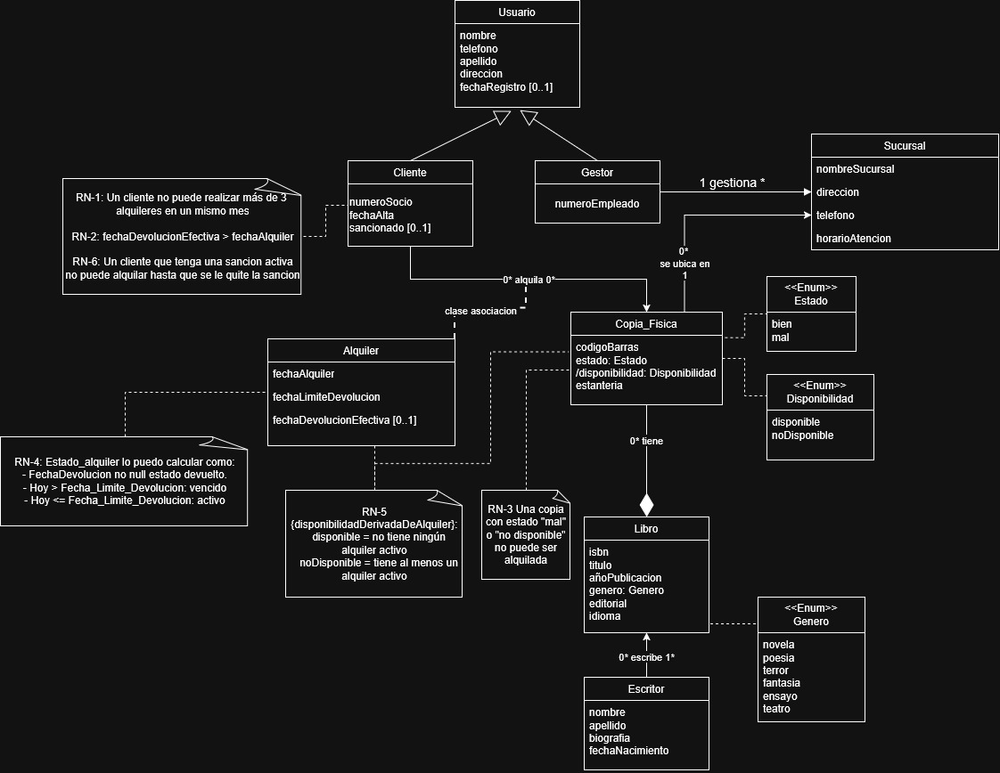
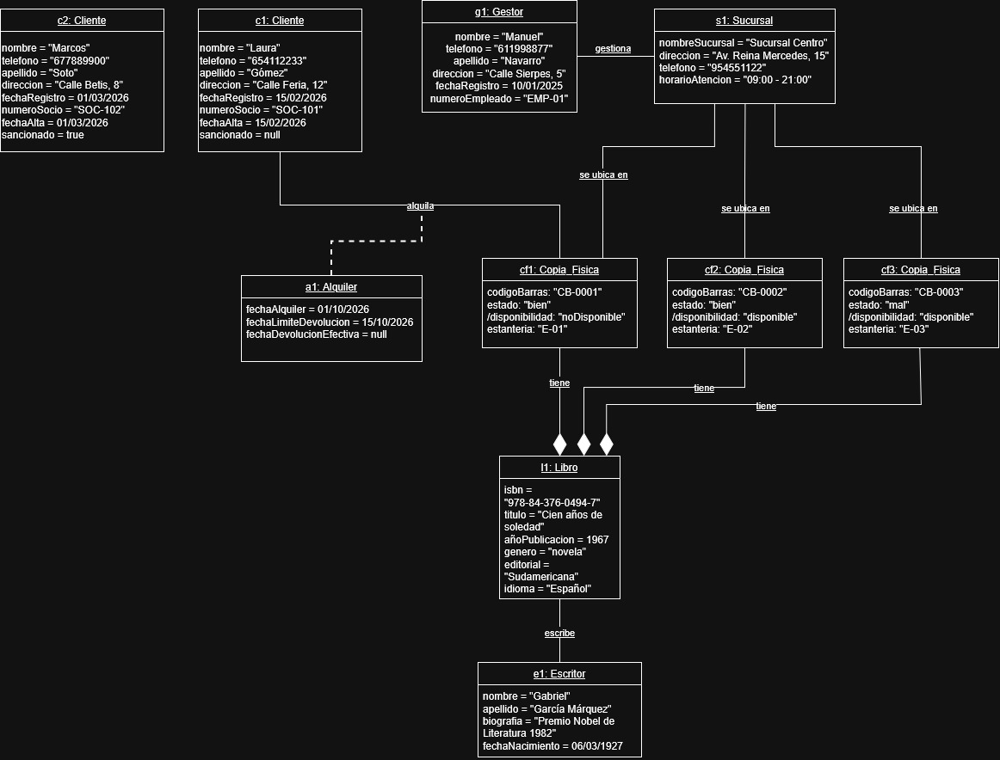

# Rincón del Libro

## Miembros del grupo L6-DF-5

1. Guerrero Fuentes, Alexandro
2. Leon Galdino, Marianna Andrea

## 1. Introducción al problema

### 1.1. Descripción del problema
El cliente solicita el desarrollo de un sistema de información para la gestión de una biblioteca que dispone de un catálogo de libros y de diferentes sucursales donde se almacenan y prestan ejemplares físicos a los usuarios.
El objetivo principal del proyecto es desarrollar una base de datos que permita almacenar, organizar y consultar toda la información relacionada con el funcionamiento de la biblioteca, facilitando la gestión de los libros, sus ejemplares físicos, los usuarios, los creadores de las obras, las sucursales y los préstamos realizados.
La biblioteca necesita disponer de un sistema centralizado que permita conocer en todo momento qué libros forman parte de su catálogo, cuántos ejemplares existen de cada obra, en qué sucursal se encuentra cada ejemplar y cuáles están disponibles para ser prestados. Asimismo, es necesario mantener un registro de los préstamos y las devoluciones para poder consultar qué usuarios tienen libros prestados y cuándo deben devolverlos.
Para satisfacer estas necesidades, se propone diseñar e implementar una base de datos relacional que permita gestionar la información de forma estructurada, segura y consistente.

### 1.2. Situación actual y problemas detectados

La gestión de una biblioteca puede resultar compleja cuando aumenta el número de libros, ejemplares, usuarios y préstamos. Si la información se almacena en documentos independientes o en sistemas no integrados, pueden aparecer problemas que dificulten el funcionamiento de la organización.

Entre los principales problemas que se pretende solucionar se encuentran los siguientes:
- **Falta de centralización de la información**: los datos de los libros, usuarios y préstamos pueden encontrarse distribuidos en diferentes documentos o sistemas.
- **Dificultad para conocer la disponibilidad**: no siempre resulta sencillo determinar si un ejemplar está disponible, prestado o pendiente de devolución.
- **Control insuficiente de los préstamos**: es necesario saber qué usuario tiene cada ejemplar y cuándo debe devolverlo.
- **Gestión de múltiples ejemplares**: una misma obra puede tener varias copias físicas, por lo que es necesario identificar cada ejemplar individualmente.
- **Organización de las sucursales**: cuando la biblioteca dispone de varias ubicaciones, se necesita conocer dónde está asignado cada ejemplar.
- **Duplicidad e inconsistencia de los datos**: registrar repetidamente la información de una misma obra o usuario puede generar errores y dificultar su actualización.
- **Dificultad para obtener información**: los gestores necesitan realizar consultas rápidas sobre los libros disponibles, los préstamos activos y el historial de los usuarios.

### 1.3. Expectativas del cliente

El cliente espera disponer de un sistema que facilite la administración de la biblioteca y mejore el acceso a la información.

En concreto, se espera que la solución permita centralizar los datos, agilizar las consultas, controlar los préstamos y las devoluciones, reducir los errores administrativos y mantener un inventario actualizado de los ejemplares físicos.

Además, el sistema deberá garantizar que la información esté correctamente relacionada, evitando situaciones como registrar préstamos de libros inexistentes o prestar simultáneamente el mismo ejemplar a varios usuarios.

En definitiva, el proyecto pretende proporcionar una solución que permita a la biblioteca gestionar sus recursos de manera organizada, mantener información fiable y ofrecer un servicio de préstamo más eficiente.

## 2. Glosario de términos

- ISBN: Código normalizado internacional que identifica de forma única un libro.

## 3. Visión general del sistema

### 3.1. Requisitos generales

  - **R.G.1. Gestión de usuarios** el sistema permitirá distinguir entre clientes y gestores y controlar las operaciones que puede realizar cada tipo de usuario.
  - **R.G.2. Gestión del catálogo** mantener actualizado el catálogo de libros y escritores, para ofrecer los fondos bibliográficos a los usuarios.
  - **R.G.3. Gestión de ejemplares y sucursales** registrar las sucursales y localizar las copias físicas en cada una de ellas, para controlar la ubicación del inventario.
  - **R.G.4. Gestión de alquileres** quiero registrar los préstamos y devoluciones de ejemplares, para supervisar el flujo de libros y verificar las fechas límite.

    
### 3.2. Usuarios del sistema 

**Clientes**: personas que utilizan los servicios de la biblioteca. 
**Gestores**: trabajadores responsables de administrar la biblioteca.

## 4. Catálogo de requisitos

### 4.1. Requisitos de información

#### R.I.1. Información de usuarios
Como gestor del sistema, quiero registrar y consultar la información de los usuarios para mantener sus datos personales y de contacto.

**Pruebas de aceptación**
- **R.I.1.1** Comprobar que se pueden registrar el nombre y los apellidos del usuario.
- **R.I.1.2** Comprobar que se puede almacenar su teléfono.
- **R.I.1.3** Comprobar que se puede almacenar su dirección.
- **R.I.1.4** Comprobar que la fecha de registro es opcional.
- **R.I.1.5** Comprobar que cada usuario tiene un identificador único.

#### R.I.2. Información de clientes
Como gestor del sistema, quiero registrar y consultar los datos específicos de los clientes para gestionar su condición de socios y controlar sus derechos de préstamo.

**Pruebas de aceptación**
- **R.I.2.1** Comprobar que cada cliente tiene un número de socio único.
- **R.I.2.2** Comprobar que se registra la fecha de alta del cliente en el sistema.
- **R.I.2.3** Comprobar que se puede registrar si el cliente tiene una sanción vigente, siendo este dato opcional.

#### R.I.3. Información de gestores
Como administrador del sistema, quiero registrar y consultar la información de los gestores para identificarlos y gestionar sus permisos administrativos.

**Pruebas de aceptación**
- **R.I.3.1** Comprobar que cada gestor tiene un número de empleado.
- **R.I.3.2** Comprobar que se puede identificar a cada gestor de forma única.

#### R.I.4. Información de sucursales
Como gestor del sistema, quiero registrar y consultar la información de las sucursales para conocer sus datos de contacto y horarios de atención.

**Pruebas de aceptación**
- **R.I.4.1** Comprobar que se puede almacenar el nombre de la sucursal.
- **R.I.4.2** Comprobar que se puede registrar su dirección.
- **R.I.4.3** Comprobar que se puede registrar su teléfono.
- **R.I.4.4** Comprobar que se puede almacenar el horario de atención.
- **R.I.4.5** Comprobar que cada sucursal puede identificarse de forma inequívoca.

#### R.I.5. Información de libros
Como usuario del sistema, quiero consultar la información de los libros para identificar sus características y conocer en qué sucursales se encuentran.

**Pruebas de aceptación**
- **R.I.5.1** Comprobar que se almacena el ISBN del libro.
- **R.I.5.2** Comprobar que se registra el título.
- **R.I.5.3** Comprobar que se puede almacenar el año de publicación.
- **R.I.5.4** Comprobar que se registra el género literario.
- **R.I.5.5** Comprobar que se almacena la editorial.
- **R.I.5.6** Comprobar que se registra el idioma.
- **R.I.5.7** Comprobar que se pueden asociar uno o varios escritores a un libro.
- **R.I.5.8** Comprobar que se puede conocer en qué sucursales está disponible un libro a través de sus copias físicas asignadas.

#### R.I.6. Información de escritores
Como usuario del sistema, quiero consultar la información de los escritores para conocer sus datos personales y su trayectoria.

**Pruebas de aceptación**
- **R.I.6.1** Comprobar que se almacenan el nombre y los apellidos del escritor.
- **R.I.6.2** Comprobar que se puede registrar su biografía.
- **R.I.6.3** Comprobar que se puede almacenar su fecha de nacimiento.
- **R.I.6.4** Comprobar que un escritor puede estar relacionado con varios libros.

#### R.I.7. Información de copias físicas
Como gestor del sistema, quiero registrar y consultar la información de las copias físicas para controlar su estado, ubicación y disponibilidad.

**Pruebas de aceptación**
- **R.I.7.1** Comprobar que cada copia física tiene un código de barras único.
- **R.I.7.2** Comprobar que se registra el estado físico de la copia, que puede ser "bien" o "mal".
- **R.I.7.3** Comprobar que se registra la disponibilidad de la copia, que puede ser "disponible" o "noDisponible".
- **R.I.7.4** Comprobar que se puede almacenar la estantería donde se ubica.
- **R.I.7.5** Comprobar que cada copia física está asignada a una sucursal.
- **R.I.7.6** Comprobar que cada copia física corresponde a un único libro.
- **R.I.7.7** Comprobar que un libro puede tener varias copias físicas.

#### R.I.8. Información de alquileres
Como gestor del sistema, quiero registrar y consultar la información de los alquileres para controlar las operaciones de préstamo de copias físicas y conservar su historial.

**Pruebas de aceptación**
- **R.I.8.1** Comprobar que se almacena la fecha de alquiler.
- **R.I.8.2** Comprobar que se registra la fecha límite de devolución.
- **R.I.8.3** Comprobar que la fecha de devolución efectiva se registra cuando se devuelve la copia y es opcional.
- **R.I.8.4** Comprobar que cada alquiler identifica unívocamente al cliente que realiza la operación.
- **R.I.8.5** Comprobar que cada alquiler identifica la copia física concreta que ha sido prestada.
- **R.I.8.6** Comprobar que no se permite registrar un alquiler sin asociar obligatoriamente un cliente y una copia física válidos.

### 4.2. Reglas de negocio

#### R.N.1. Máximo de alquileres por cliente
Un cliente no puede realizar más de 3 alquileres en un mismo mes.

**Pruebas de aceptación**
- **R.N.1.1** Comprobar que el sistema permite a un cliente realizar hasta 3 alquileres en el mismo mes.
- **R.N.1.2** Comprobar que el sistema impide a un cliente realizar un cuarto alquiler en el mismo mes.

#### R.N.2. Validación de la fecha de devolución efectiva
La fecha de devolución efectiva debe ser posterior a la fecha de alquiler.

**Pruebas de aceptación**
- **R.N.2.1** Comprobar que el sistema permite registrar una fecha de devolución efectiva posterior a la fecha de alquiler.
- **R.N.2.2** Comprobar que el sistema impide registrar una fecha de devolución efectiva anterior a la fecha de alquiler.

#### R.N.3. Copia alquilable
Una copia con estado "mal" o "no disponible" no puede ser alquilada.

**Pruebas de aceptación**
- **R.N.3.1** Comprobar que el sistema permite alquilar una copia con estado "bien" y disponible.
- **R.N.3.2** Comprobar que el sistema impide alquilar una copia con estado "mal".
- **R.N.3.3** Comprobar que el sistema impide alquilar una copia que está "no disponible".

#### R.N.4. Estado del alquiler calculable
El estado de un alquiler se calcula de la siguiente forma:
- Si la fecha de devolución no es nula, el estado es "devuelto".
- Si hoy es posterior a la fecha límite de devolución, el estado es "vencido".
- Si hoy es anterior o igual a la fecha límite de devolución, el estado es "activo".

**Pruebas de aceptación**
- **R.N.4.1** Comprobar que un alquiler con fecha de devolución registrada se muestra como "devuelto".
- **R.N.4.2** Comprobar que un alquiler sin devolución y con fecha límite ya pasada se muestra como "vencido".
- **R.N.4.3** Comprobar que un alquiler sin devolución y con fecha límite no pasada se muestra como "activo".

#### R.N.5. Disponibilidad derivada de los alquileres
La disponibilidad de una copia física se deriva de sus alquileres:
- "disponible": no tiene ningún alquiler activo.
- "noDisponible": tiene al menos un alquiler activo.

**Pruebas de aceptación**
- **R.N.5.1** Comprobar que una copia sin alquileres activos se muestra como "disponible".
- **R.N.5.2** Comprobar que una copia con un alquiler activo se muestra como "noDisponible".
- **R.N.5.3** Comprobar que una copia pasa a estar "disponible" después de registrar la devolución de su alquiler activo.

#### R.N.6. Clientes con sanción activa
Un cliente que tenga una sanción vigente no puede realizar nuevos alquileres mientras dure dicha restricción.

**Pruebas de aceptación**
- **R.N.6.1** Comprobar que el sistema impide registrar un alquiler a un cliente que tenga el campo de sanción activo.
- **R.N.6.2** Comprobar que el sistema permite realizar alquileres con normalidad a aquellos clientes que no figuren como sancionados.

### 4.3. Requisitos funcionales

#### R.F.1. Listado del catálogo de libros
Como cliente, quiero obtener un listado de los libros pudiendo filtrar por título, escritor, género, editorial o idioma, para localizar obras de mi interés.

**Pruebas de aceptación**
- **R.F.1.1** Verificar que el sistema muestra el catálogo y permite filtrar por título (R.I.5.2), escritor (R.I.5.7), género (R.I.5.4), editorial (R.I.5.5) e idioma (R.I.5.6), devolviendo únicamente los libros que cumplen los criterios seleccionados.
- **R.F.1.2** Verificar que, al realizar una búsqueda sin resultados coincidentes, el sistema muestra un listado vacío e informa al usuario de que no se han encontrado libros.
- **R.F.1.3** Verificar que un libro con varios escritores aparece correctamente relacionado con todos ellos (R.I.5.7).

#### R.F.2. Consultar disponibilidad de un libro
Como cliente, quiero consultar la disponibilidad de un libro (qué copias físicas están disponibles y en qué sucursal se encuentran), para saber si puedo alquilarlo.

**Pruebas de aceptación**
- **R.F.2.1** Verificar que el sistema muestra las copias físicas disponibles del libro seleccionado (R.I.7.3), indicando la sucursal en la que se encuentra cada una (R.I.7.5).
- **R.F.2.2** Verificar que, cuando todas las copias físicas del libro están alquiladas, el sistema indica que no hay ejemplares disponibles para alquilar (R.N.5).
- **R.F.2.3** Se debe aplicar la regla de negocio R.N.5 (disponibilidad derivada de los alquileres).

#### R.F.3. Listado de copias físicas
Como gestor, quiero obtener un listado de las copias físicas de un libro o de una sucursal, mostrando su estado y su estantería, para localizar los ejemplares.

**Pruebas de aceptación**
- **R.F.3.1** Verificar que el gestor puede consultar las copias físicas de un libro concreto y que cada resultado muestra su identificador, estado (R.I.7.2) y estantería (R.I.7.4).
- **R.F.3.2** Verificar que el gestor puede consultar las copias físicas de una sucursal determinada y que únicamente se muestran las copias asignadas a dicha sucursal (R.I.7.5).

#### R.F.4. Listado de clientes
Como gestor, quiero obtener un listado de los clientes (socios) de la biblioteca con sus datos, para tenerlos localizados.

**Pruebas de aceptación**
- **R.F.4.1** Verificar que el gestor puede consultar el listado de clientes y que cada registro muestra los datos definidos para el socio (R.I.2.1), como nombre y apellidos (R.I.1.1) y datos de contacto (R.I.1.2).
- **R.F.4.2** Verificar que cada cliente aparece identificado de forma inequívoca y que no existen identificadores duplicados entre los usuarios registrados (R.I.1.5).

#### R.F.5. Listado de clientes sancionados
Como gestor, quiero obtener un listado de los clientes que están sancionados, para saber a quiénes no se les puede alquilar.

**Pruebas de aceptación**
- **R.F.5.1** Verificar que el sistema muestra únicamente los clientes que tienen una sanción vigente (R.I.2.3), incluyendo sus datos identificativos.
- **R.F.5.2** Verificar que los clientes sin sanciones vigentes no aparecen en el listado y y que a los sancionados se les aplica la restricción de préstamo (R.I.2.3, R.N.6).

#### R.F.6. Listado de alquileres activos
Como gestor, quiero obtener un listado de los alquileres activos (todavía no devueltos y dentro de plazo), para hacer el seguimiento de las operaciones en curso.

**Pruebas de aceptación**
- **R.F.6.1** Verificar que el sistema muestra todos los alquileres que todavía no han sido devueltos y cuya fecha límite de devolución no ha pasado (R.N.4.3), indicando los datos del cliente, el libro, la copia física y las fechas del alquiler y de devolución prevista (R.I.8.1, R.I.8.2).
- **R.F.6.2** Verificar que, cuando una copia física se devuelve y el alquiler queda registrado como finalizado (R.I.8.3), dicho alquiler deja de aparecer en el listado de alquileres activos (R.N.4.1).
- **R.F.6.3** Se debe aplicar la regla de negocio R.N.4 (estado del alquiler calculable).

#### R.F.7. Listado de alquileres vencidos
Como gestor, quiero obtener un listado de los alquileres cuya fecha límite de devolución ya ha pasado y aún no han sido devueltos, para identificar a los usuarios morosos.

**Pruebas de aceptación**
- **R.F.7.1** Verificar que el sistema muestra los alquileres que no han sido devueltos y cuya fecha prevista de devolución es anterior a la fecha actual (R.N.4.2), indicando el cliente, el libro y los datos del alquiler.
- **R.F.7.2** Verificar que los alquileres cuya fecha prevista de devolución coincide con la fecha actual o es posterior a ella no aparecen como vencidos, y que los alquileres ya devueltos tampoco se incluyen en el listado (R.N.4).
- **R.F.7.3** Se debe aplicar la regla de negocio R.N.4 (estado del alquiler calculable).

#### R.F.8. Listado de escritores
Como cliente, quiero consultar el listado de escritores y su información, para conocer los autores disponibles en la biblioteca.

**Pruebas de aceptación**
- **R.F.8.1** Verificar que el sistema muestra el listado de escritores registrados y la información disponible de cada uno, como su identificador, nombre (R.I.6.1) y datos biográficos (R.I.6.2), si están definidos.
- **R.F.8.2** Verificar que, al seleccionar un escritor, el sistema permite identificar los libros asociados a él (R.I.6.4) y que un libro con varios creadores aparece relacionado con todos ellos (R.I.5.7).

#### R.F.9. Listado de sucursales
Como cliente, quiero consultar las sucursales de la biblioteca con su dirección, teléfono y horario de atención, para saber dónde acudir.

**Pruebas de aceptación**
- **R.F.9.1** Verificar que el sistema muestra el listado de sucursales con su dirección (R.I.4.2), teléfono (R.I.4.3) y horario de atención (R.I.4.4) correspondiente.
- **R.F.9.2** Verificar que, al seleccionar una sucursal, se muestra su información específica y que los datos de las distintas sucursales no se confunden entre sí (R.I.4.5).

#### R.F.10. Listado de libros de una sucursal
Como gestor, quiero consultar los que disponen de ejemplares fisicos en una sucursal determinada, para conocer el fondo de cada sede.

**Pruebas de aceptación**
- **R.F.10.1** Verificar que el gestor puede seleccionar una sucursal y obtener el listado de libros que cuentan con copias físicas ubicadas en dicha sede (R.I.5.8, R.I.7.5).
- **R.F.10.2** Verificar que un libro que tiene copias físicas repartidas en varias sucursales aparece en el listado de cada una de ellas (R.I.5.8).

#### R.F.11. Consultar la información de un libro
Como cliente, quiero consultar los datos de un libro concreto (título, escritor/es, año, género, editorial e idioma), para decidir si me interesa.

**Pruebas de aceptación**
- **R.F.11.1** Verificar que, al seleccionar un libro del catálogo, el sistema muestra su título (R.I.5.2), escritor o escritores (R.I.5.7), año de publicación (R.I.5.3), género (R.I.5.4), editorial (R.I.5.5) e idioma (R.I.5.6), siempre que estos datos estén registrados.
- **R.F.11.2** Verificar que, al consultar un libro con varios creadores, el sistema muestra a todos los creadores asociados (R.I.5.7) y que, si el identificador del libro no existe, informa de que no se ha encontrado el libro solicitado (R.I.5.1).

### 4.4. Requisitos no funcionales

#### R.N.F.1. Control de acceso
Como director de la biblioteca, quiero que solo los gestores puedan acceder a las funciones de gestión y que los clientes únicamente consulten el catálogo y sus propios datos, para proteger la información.

#### R.N.F.2. Usabilidad
Como cliente, quiero una interfaz sencilla e intuitiva para consultar el catálogo.

#### R.N.F.3. Disponibilidad
Como gestor, quiero que el sistema esté disponible durante todo el horario de apertura de las sucursales, para poder atender de la mejor forma posible al cliente.

#### R.N.F.4. Seguridad de los datos
Como director de la biblioteca, quiero que los datos personales de los clientes y la información de sus alquileres se almacenen de forma segura, para evitar accesos no autorizados y proteger su privacidad.

#### R.N.F.5. Compatibilidad
Como cliente, quiero poder acceder al sistema desde los navegadores web más utilizados y desde diferentes dispositivos, para consultar el catálogo independientemente del equipo que utilice.

### 4.5. Mapa de historias de usuario

| Actividad | Tarea | Historia de usuario | Prioridad |
|-----------|-------|---------------------|-----------|
| Catálogo de libros | Buscar libros | Como cliente, quiero buscar libros por título para localizar las obras que me interesan. | Alta |
| Catálogo de libros | Consultar disponibilidad | Como cliente, quiero conocer qué ejemplares están disponibles y en qué sucursal. | Alta |
| Catálogo de libros | Registrar libros | Como gestor, quiero registrar libros y creadores para mantener actualizado el catálogo. | Alta |
| Catálogo de libros | Registrar copias físicas | Como gestor, quiero registrar copias físicas y asignarlas a sucursales. | Alta |
| Catálogo de libros | Consultar información | Como cliente, quiero consultar la información detallada de un libro para decidir si me interesa. | Media |
| Catálogo de libros | Filtrar resultados | Como cliente, quiero filtrar los libros por escritor, género, editorial e idioma para encontrar obras de mi interés. | Media |
| Gestión de sucursales | Consultar sucursales | Como cliente, quiero consultar las direcciones, teléfonos y horarios de las sucursales para saber dónde acudir. | Media |
| Gestión de sucursales | Consultar copias físicas | Como gestor, quiero consultar las copias físicas por libro o sucursal, incluyendo su estado y estantería, para localizar los ejemplares. | Alta |
| Gestión de clientes | Registrar clientes | Como gestor, quiero registrar nuevos clientes para permitirles utilizar los servicios de la biblioteca. | Alta |
| Gestión de clientes | Gestionar sanciones | Como gestor, quiero registrar y actualizar sanciones para controlar las restricciones aplicadas a los clientes. | Media |
| Gestión de alquileres | Consultar alquileres propios | Como cliente, quiero consultar mis alquileres activos y las fechas previstas de devolución. | Alta |
| Gestión de alquileres | Registrar alquileres | Como gestor, quiero registrar alquileres para saber qué ejemplares tiene cada cliente. | Alta |
| Gestión de alquileres | Registrar devoluciones | Como gestor, quiero registrar devoluciones para actualizar la disponibilidad de los ejemplares. | Alta |
| Gestión de alquileres | Consultar historial | Como gestor, quiero consultar el historial de alquileres para revisar las operaciones realizadas. | Media |
| Gestión de alquileres | Consultar alquileres activos | Como gestor, quiero consultar los alquileres activos para realizar el seguimiento de los ejemplares alquilados. | Alta |
| Gestión de alquileres | Consultar alquileres vencidos | Como gestor, quiero consultar los alquileres vencidos para identificar las devoluciones pendientes. | Media |
| Gestión de alquileres | Validar disponibilidad | Como gestor, quiero que el sistema compruebe la disponibilidad de una copia antes de registrar un alquiler para evitar asignaciones duplicadas. | Alta |
| Gestión de alquileres | Validar clientes | Como gestor, quiero que el sistema compruebe que un cliente cumple las condiciones antes de registrar un alquiler. | Alta |

## 5. Modelo conceptual

### 5.1. Diagrama de clases UML

### 5.2. Escenarios de prueba
#### 5.2.1. Diagrama de escenario de prueba UML:

#### 5.2.2. Descripción textual:
Se comprueba el comportamiento del sistema ante operaciones de consulta y préstamo sobre una sede física:

1. **Gestión de la sede:**
   - La sede **"Sucursal Centro"** (s1: Sucursal) está gestionada por el empleado **Manuel Navarro** (g1: Gestor), vinculado mediante el enlace "gestiona".

2. **Catálogo y autores:**
   - En el catálogo está registrada la novela **"Cien años de soledad"** (l1: Libro), cuyo autor es **Gabriel García Márquez** (e1: Escritor), relacionados mediante el enlace "escribe".

3. **Copias físicas y disponibilidad (RN-3 y RN-5):**
   - El libro se compone mediante "tiene" de tres ejemplares físicos ubicados en la sucursal ("se ubica en"):
     - **cf1: Copia_Fisica**: En estantería "E-01", en estado "bien". Al tener un alquiler activo en curso (a1: Alquiler), la regla **RN-5** deriva su disponibilidad a /disponibilidad = "noDisponible".
     - **cf2: Copia_Fisica**: En estantería "E-02", en estado "bien". No tiene ningún alquiler activo, por lo que **RN-5** deriva su disponibilidad a /disponibilidad = "disponible". Es un ejemplar completamente apto para ser alquilado (**RN-3**).
     - **cf3: Copia_Fisica**: En estantería "E-03", en estado "mal". Aunque no tiene alquileres activos y figura como /disponibilidad = "disponible", la regla **RN-3** impide que pueda alquilarse debido a su deterioro físico.

4. **Operaciones de clientes (RN-1, RN-4 y RN-6):**
   - **c1: Cliente (Laura Gómez)**: Socia no sancionada (sancionado = null). Tiene en curso el alquiler **a1: Alquiler** sobre la copia **cf1** mediante el enlace "alquila". Al ser su único préstamo del mes, cumple el límite máximo de 3 alquileres mensuales (**RN-1**). Como la fecha de devolución efectiva no se ha registrado (fechaDevolucionEfectiva = null) y aún no ha vencido la fecha límite (15/10/2026), el estado del alquiler se calcula como "activo" (**RN-4**).
   - **c2: Cliente (Marcos Soto)**: Socio con sanción activa (sancionado = true). En aplicación de la regla **RN-6**, el sistema bloquea cualquier intento de registrar un nuevo alquiler a su nombre mientras persista la sanción.

## 6. Matrices de trazabilidad

- Matriz de trazabilidad entre los elementos del modelo conceptual y los requisitos.

|       | Entidad Usuario | Entidad Gestor | Asociación gestiona | Entidad Sucursal | Asociación &nbsp;&nbsp;&nbsp;&nbsp;&nbsp;&nbsp; se ubica en | Entidad Cliente | Asociación alquila | Entidad Alquiler | 
|:------|:-----------|:-----------|:-----------|:-----------|:-----------|:-----------|:-----------|:-----------|
| RI-1  |   
 x 
     |      x      |            |            |            |            |           |           |                
| RI-2  |            |     x      |            |           |           |   x        |           |           |           
| RI-3  |            |           |            |           |           |           |           |           |          
| RI-4  |            |      x     |     x       |      x     |           |           |           |           |          
| RI-5  |     x       |           |            |           |           |           |           |           |           
| RI-6  |      x      |          |            |           |           |           |           |           |           
| RI-7  |            |     x      |            |           |           |           |           |           |          
| RI-8                   |            |           |      x      |           |           |           |           |           |           
| RF-1  &nbsp;                 |            |           |            |           |           |           |           |           |         
| RF-2  &nbsp;               |           |            |           |          |           |      x     |           |           |           
| RF-3  &nbsp;                 |           |           |           |      x     |     x      |           |           |           |          
| RF-4  &nbsp;                 |           |      x      |           |           |           |     x      |           |           |         
| RF-5  &nbsp;                 |           |       x     |           |           |           |     x      |           |           |          
| RF-6  &nbsp;                 |           |      x      |           |           |           |           |     x      |     x      |           
| RF-7  &nbsp;                 |           |            |           |           |           |           |           |           |         
| RF-8  &nbsp;                 |           |            |           |           |           |    x       |           |           |          
| RF-9  &nbsp;                 |     x      |            |           |    x       |           |           |           |           |           
| RF-10  &nbsp; &nbsp; &nbsp;               |           |      x      |     x      |     x      |     x      |           |           |           |          
| RF-11  &nbsp; &nbsp; &nbsp;               |           |            |          |           |           |      x     |           |           |          

|       | Entidad Copia_Fisica | Asociación tiene | Entidad Libro | Asociación escribe | Entidad Escritor | 
|:------|:-----------|:-----------|:-----------|:-----------|:-----------|
| RI-1  |      x     |           |           |           |           |           
| RI-2  |            |           |            |           |           |
| RI-3  |            |           |            |           |           |
| RI-4  |            |           |            |           |           |
| RI-5  |            |           |      x      |           |           |
| RI-6  |            |          |            |           |     x      | 
| RI-7  |     x       |           |            |           |           |  
| RI-8  |            |           |            |           |           | 
| RF-1 &nbsp; |            |           |      x      |      x     |    x       |  
| RF-2 &nbsp; |     x      |     x       |    x       |          |           |   
| RF-3 &nbsp; |      x     |      x      |     x      |           |           |    
| RF-4 &nbsp; |           |            |           |           |           | 
| RF-5 &nbsp; |           |            |           |           |           |  
| RF-6 &nbsp; |           |            |           |           |           |  
| RF-7 &nbsp; |     x      |            |           |           |           | 
| RF-8 &nbsp; |           |            |           |           |       x    |  
| RF-9 &nbsp; |           |            |           |           |           | 
| RF-10 &nbsp; &nbsp; &nbsp;|     x      |      x      |     x      |           |           | 
| RF-11 &nbsp; &nbsp; &nbsp; |           |            |    x      |           |           | 

-- fin entregable 2 --

## 7. Modelo relacional en 3FN

- Relaciones obtenidas al aplicar la transformación del modelo conceptual.

### 7.1.  Justificación de la estrategia de transformación de jerarquías

- si se identificaron jerarquías en el MC.

### 8. Matriz de trazabilidad MC/SQL (opcional):

- Restricciones sobre el MC / Elementos del modelo tecnológico (SQL) (Triggers, checks, etc.)
- Incluir Reglas de negocio — Constraints/Triggers en las matrices de trazabilidad para el entregable 3

|       | EntidadX   | AsociaciónX  | RestricciónX  | Entidad2 ...   | 
|:-------|:-------|:-------|:-------|:-------|
| TABLA-1 |        |        |        |        |
| TABLA-2 |        |        |        |        |
| TABLA-3 |        |        |        |        |
| TABLA-4 |        |        |        |        |
| TRIG-1 |        |        |        |        |
| TRIG-2 | X      | X      |        | X      |
| TRIG-3 |        | X      |        | X      |
| TRIG-4 |        |        | X      |        |
| CONST-1 |        |        |        |        |
| CONST-2 | X      | X      |        | X      |
| CONST-3 |        | X      |        | X      |
| CONST-4 |        |        | X      |        |

Se consideran todo tipo de constraints declarativas (aquellas definidas durante el CREATE TABLE).
-- fin entregable 3 --

## Referencias

Gemini/ChatGPT - Consultas varias sobre Biblioteca (funcionamiento,problemas,etc) [https://gemini.google.com/app?hl=es] [https://chatgpt.com/]

Lucid - Como crear mapa historia de usuario [https://lucid.co/es/blog/como-crear-un-mapa-de-historias-de-usuario]

Github.docs - Escritura y formato en Markdown[https://docs.github.com/es/get-started/writing-on-github/getting-started-with-writing-and-formatting-on-github/basic-writing-and-formatting-syntax]
